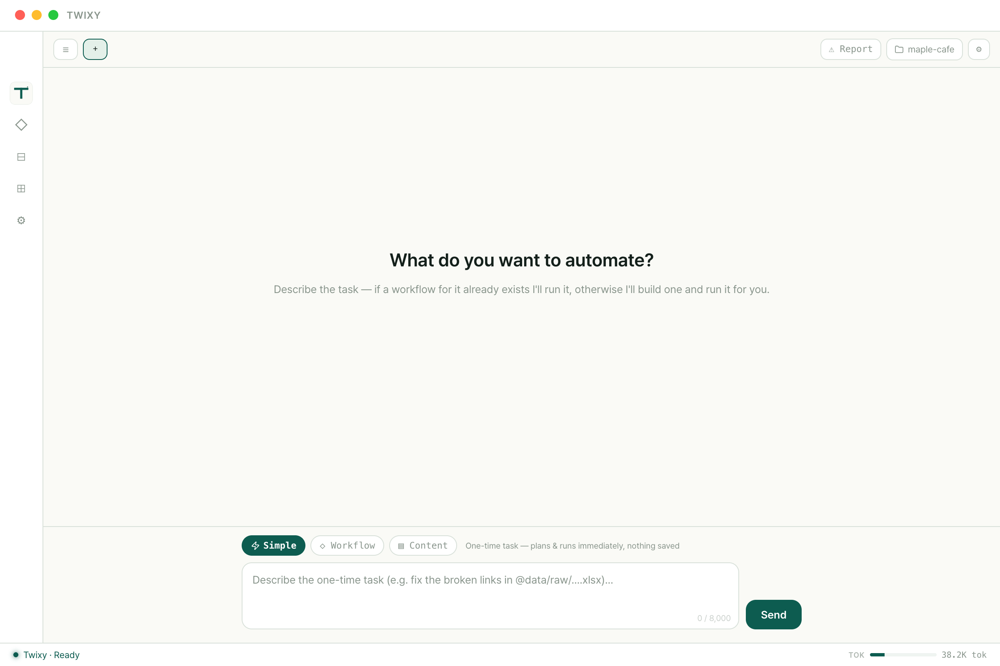
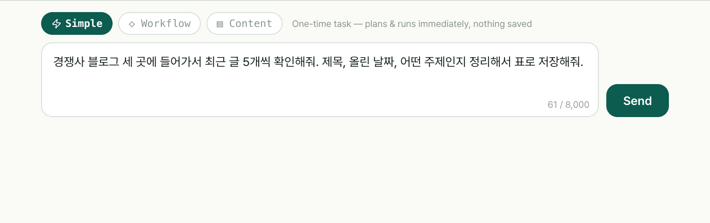
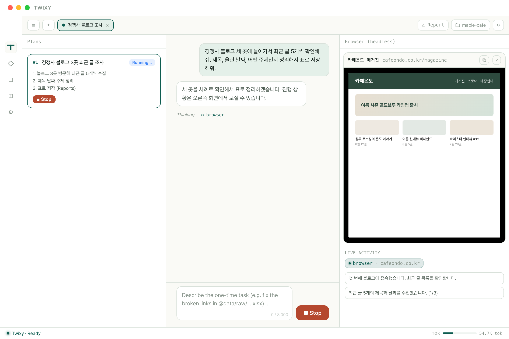
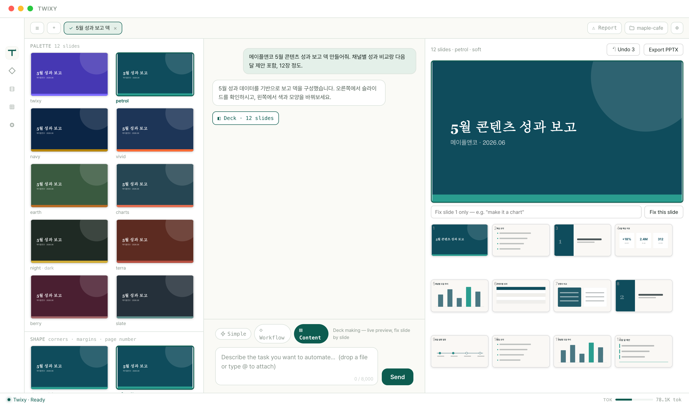
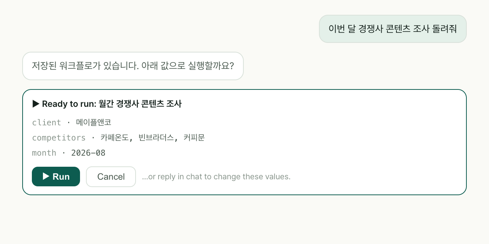
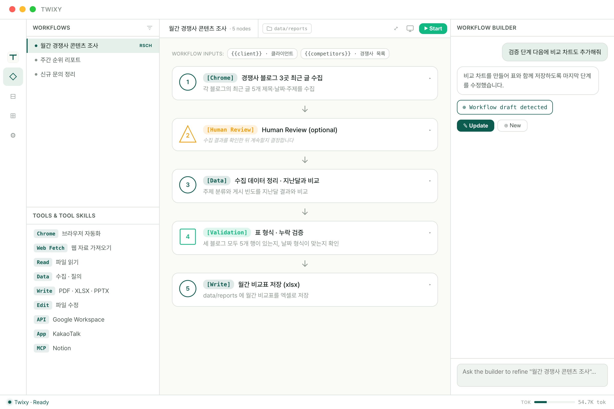
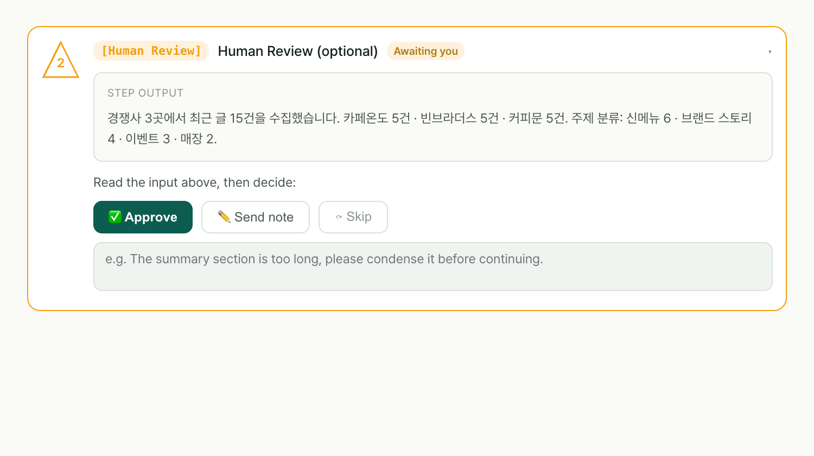
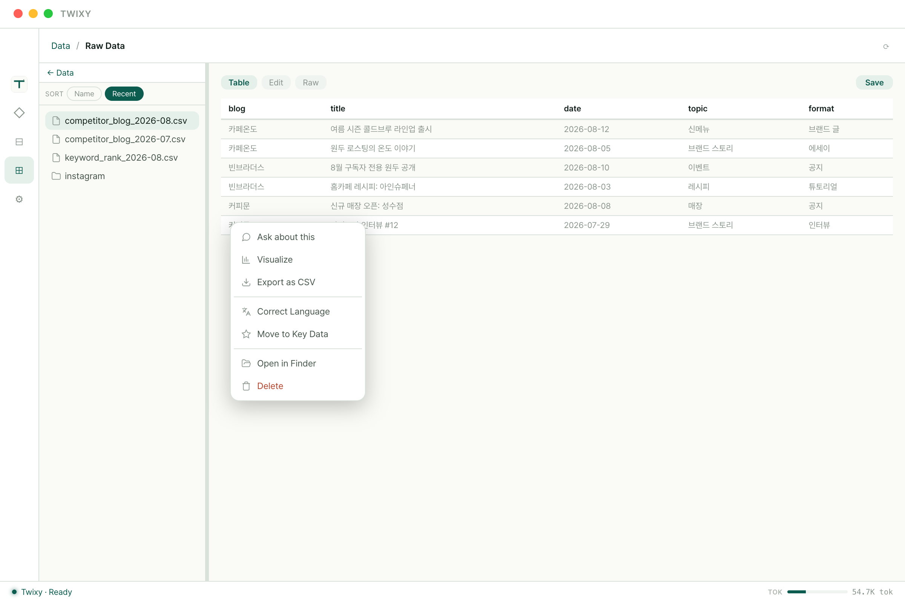

# 트윅시 사용 설명서

**조작 안내서**
버전 0.1.0 · 2026년 8월

---

## 0. 이 문서 읽는 법

이 문서는 **트윅시를 실제로 어떻게 조작하는지**만 다룹니다. 어떤 제품인지, 왜 쓰는지, 요금은 얼마인지는 **제품 소개서**에 따로 있습니다.

- **설치부터 처음이시면** → **1. 설치하고 시작하기**부터 순서대로.
- **이미 설치하셨으면** → **2. 첫 작업 따라하기**를 15분만 따라 해보세요.
- **뭘 어떻게 시키는지 찾으시면** → **3. 작업별 따라하기**가 본문입니다. 하고 싶은 일을 찾아서 그 부분만 보시면 됩니다.
- **결과가 이상하게 나오면** → **6. 원하는 대로 안 나올 때**.
- **아예 안 되면** → **7. 막혔을 때**.

앱 화면은 영어입니다. 이 문서에서 **`이렇게 표시한 것`** 은 화면에 그대로 그렇게 적혀 있다는 뜻입니다.

---

## 1. 설치하고 시작하기

### 준비물

**컴퓨터** — 맥이든 윈도우든 평소 쓰시는 업무용이면 충분합니다.
**크롬 브라우저** — 트윅시가 크롬으로 사이트를 돌아다닙니다. 없으면 먼저 설치해주세요.
**트윅시 계정** — 홈페이지에서 만드실 수 있습니다.

### 설치

맥이면 받으신 파일을 열어 트윅시 아이콘을 응용 프로그램 폴더로 끌어다 놓으세요. 윈도우면 설치 파일을 실행하고 안내를 따르시면 됩니다.

### 로그인

앱을 켜면 로그인 화면이 나옵니다. **`Sign in with web`** 을 누르면 **평소 쓰시는 웹 브라우저가 열립니다.** 거기서 로그인을 마치면 앱이 알아서 열립니다. 브라우저가 안 열렸으면 **`Open sign-in page again`** 을 누르세요.

### 처음에 나오는 안내창

**맥 권한 팝업** — 화면 기록, 브라우저 조작 같은 권한을 물어봅니다. 전부 허용해주세요. 특히 **로컬 네트워크**는 막으면 앱이 아예 동작하지 않습니다. 인터넷으로 뭘 보내는 게 아니라, 컴퓨터 안에서 트윅시의 두 부분이 대화하는 통로입니다.

**`Setup required` 화면 (주로 윈도우)** — 버튼 한 번 누르면 필요한 부품을 알아서 설치합니다. 관리자 비밀번호도 필요 없습니다.

**`Starting copilot…`** — 엔진이 켜지는 중입니다. 처음에는 조금 걸립니다.

**폴더 선택 창** — 처음 뭔가를 시키면 뜹니다. 트윅시가 만든 파일이 쌓일 곳입니다. 잘 모르시겠으면 기본값 그대로 두세요.

### 화면 구성

왼쪽 아이콘 막대에 탭이 다섯 개 있습니다.

| 아이콘 | 이름 | 언제 쓰나 |
|---|---|---|
| 로고 | **`Chat`** | **여기서 다 시작합니다.** 시킬 일을 말로 씁니다 |
| ◇ | **`Workflow`** | 저장해둔 반복 작업을 열어보고 고칩니다 |
| ⊟ | **`Dashboard`** | 뭐가 언제 돌았는지, 팀이 뭘 공유했는지 봅니다 |
| ⊞ | **`Data Management`** | 만들어진 파일을 봅니다 |
| ⚙ | **`Settings`** | 계정·사용량·연동 설정 |

맨 아래 띠에 상태가 나옵니다. **`Ready`**(초록)면 정상, **`Error`**(빨강)면 7장을 보세요.



---

## 2. 첫 작업 따라하기 — 15분

기능을 다 볼 필요 없습니다. **파일 하나가 만들어지는 것**만 해봅니다.

**① `Chat` 탭에서 시작합니다.** 가운데 **`What do you want to automate?`** 라고 적힌 화면입니다.

**② 입력창 위 칩 세 개 중 맨 왼쪽 `⚡ Simple` 을 누릅니다.** 한 번만 하고 말 일에 쓰는 모드입니다.



**③ 이렇게 적고 엔터를 누릅니다.** 회사에 맞게 바꾸셔도 됩니다.

```
경쟁사 블로그 세 곳에 들어가서 최근 글 5개씩 확인해줘.
제목, 올린 날짜, 어떤 주제인지 정리해서 표로 저장해줘.

https://경쟁사1.com/blog
https://경쟁사2.com/blog
https://경쟁사3.com/blog
```

**④ 오른쪽 화면을 봅니다.** 브라우저가 열리면서 트윅시가 사이트를 돌아다니는 모습이 보입니다. 그 아래로 지금 뭘 하는지 한 줄씩 올라옵니다. 가만히 보셔도 되고 다른 일 하셔도 됩니다.



**⑤ 끝나면 채팅에 파일 이름이 나옵니다.** 눌러서 바로 열어보실 수 있습니다. **`Data Management`** 탭에 가면 폴더에 정리되어 있습니다.

> 로그인 화면에서 멈췄다면 고장이 아닙니다. **4. 로그인이 필요한 사이트**를 보세요. 한 번만 해주면 됩니다.

---

## 3. 작업별 따라하기

하고 싶은 일을 찾아 그 부분만 보시면 됩니다.

### 3-1. 사이트 돌면서 자료 모으기

**어디서** — `Chat` 탭, **`⚡ Simple`**

**뭐라고 적나** — 어디를 볼지, 무엇을 가져올지, 어떤 모양으로 저장할지 세 가지를 적습니다.

```
이 키워드로 검색했을 때 1페이지에 뜨는 사이트 10곳을 정리해줘.
제목, 주소, 어떤 내용인지 요약해서 표로 저장해줘.
```
```
@계정명 의 게시물을 전부 확인해서
반응이 좋았던 순서대로 정렬해서 저장해줘
```
```
영상 두 개에서 댓글 100개씩 모아서 표 파일로 만들어줘
```

**결과** — `Data Management` 의 **Raw Data** 폴더에 표 파일로 저장됩니다.

**요령** — "정리해줘"보다 **"표로 만들어서 저장해줘"** 가 훨씬 잘 나옵니다. 결과 모양을 같이 말해주세요.

### 3-2. 모은 자료 분석하기

**어디서** — `Chat` 탭. 분석할 파일을 붙여서 시킵니다.

**파일 붙이는 법 세 가지** — 입력창에 파일을 **끌어다 놓거나**, 입력창에서 **`@`** 를 눌러 최근 파일에서 고르거나, 파일 이름을 그냥 적으셔도 됩니다.

```
@파일명 두 개를 각각 분석하고, 합쳐서 한 번 더 본 다음
자주 나오는 단어 위주로 정리해줘
```
```
@파일명 에서 본문 열만 뽑아서 어떤 단어가 자주 나오는지 분석해줘
```

**한 번에 시켜도 됩니다** — "조사해서 → 분석하고 → 저장해줘"를 한 문장에 담으셔도 알아서 단계를 나눕니다.

### 3-3. 발표용 슬라이드 만들기

**어디서** — `Chat` 탭, 칩에서 **`▤ Content`**

**① 만들 덱을 설명합니다.**

```
신규 클라이언트 제안서를 만들어줘.
- 경쟁사 세 곳 비교
- 우리가 제안하는 콘텐츠 방향 세 가지
- 3개월 실행 일정
- 예상 비용
차분하고 신뢰감 있는 느낌으로, 12장 정도로.
```

**② 잠깐 아무것도 안 보입니다. 정상입니다.** 트윅시가 자기가 만든 슬라이드를 스스로 검사하는 중입니다. 글자가 넘쳤는지, 겹친 데는 없는지 확인하고 고친 다음에 보여줍니다.

**③ 왼쪽에서 디자인을 고릅니다.** 고르기 전에 지금 보고 있는 슬라이드가 그 디자인으로 어떻게 보이는지 미리 그려줍니다.



- **색과 글꼴** — 열 가지 중에 고릅니다. 격식 있는 감청색, 따뜻한 흙색, 검정 바탕 등.
- **모서리와 여백** — 빽빽하게 할지 여유 있게 할지.
- **브랜드 색** — 클라이언트 로고 색을 하나 넣으면 **슬라이드 전체가 그 색에 맞춰 바뀝니다.**
- **이 장의 모양** — 지금 보는 장만 다른 배치로.

**④ 마음에 안 드는 장만 고칩니다.** 그 슬라이드를 고른 뒤 아래 칸에 적고 **`Fix this slide`** 를 누르세요. 다른 장은 안 건드립니다.

```
글이 너무 많아. 표로 바꿔줘.
```

**⑤ 되돌리려면 `↶ Undo`.** 앱을 끄면 되돌리기 기록은 사라집니다.

**⑥ `Export PPTX` 를 누르면** 파워포인트 파일로 저장되고, 바로 **`Open`** 과 **`Show in folder`** 버튼이 나옵니다.

> 이미 만들어둔 파워포인트를 붙이면 내용을 읽어옵니다. **내용만 가져오고 디자인은 안 가져옵니다.** 원하는 스타일은 말로 알려주세요.

### 3-4. 가지고 있는 파일 정리하기

**어디서** — `Chat` 탭. 파일을 붙여서 시킵니다.

```
@파일명 이거 엑셀로 바꿔줘
```
```
표 순서가 잘못됐어. 맨 앞에 날짜 열 추가하고 순서 바로잡아줘
```
```
표 안에 영어로 된 것들 한국어로 바꿔서 채워줘
```
```
이 보고서에서 이모지 다 빼줘. 격식 있어 보이지 않아.
다른 건 건드리지 말고.
```

**원본을 지키려면** — **"복사본으로 만들어줘"** 또는 **"원본은 그대로 두고"** 라고 하세요. 실제로 잘 동작합니다.

### 3-5. 매달 반복하는 일로 저장해두기

**어디서** — `Chat` 탭, 칩에서 **`◇ Workflow`**

**① 반복할 일을 설명합니다.** 그러면 트윅시가 그 과정을 저장합니다.

```
매달 클라이언트 다섯 곳의 검색 순위와 새로 올라온 콘텐츠를 확인해서
지난달과 비교하는 표로 만드는 걸 저장해줘
```

**② 실행 전 확인 창이 뜹니다.** 이번에 쓸 값이 나열됩니다. 맞으면 **`▶ Run`**. 값을 바꾸려면 **버튼을 누르지 말고 채팅으로 말씀하세요.** "클라이언트를 A, B, C로 바꿔줘" 하면 됩니다.



**③ 저장된 작업은 `◇ Workflow` 탭에서 봅니다.** 단계가 도형으로 보이고, 거기서 고칠 수도 있습니다.



**④ 중간에 사람이 확인하는 단계를 넣을 수 있습니다.** 조사가 끝난 뒤 "이대로 진행할까요?" 하고 멈추게 하는 겁니다. 그 자리에서 **`✅ Approve`**(좋아요), **`✏️ Send note`**(고칠 점 알려주기), **`⤼ Skip`**(건너뛰기) 중에 고릅니다.



**⑤ 다음 달에는** 클라이언트 이름만 바꿔서 다시 실행하면 됩니다.

**⑥ 팀에 공유하려면 `Share to team`.** 동료는 자기 것으로 복사해서 씁니다.

### 3-6. 링크 여러 개 한꺼번에 확인하기

사람이 하면 제일 지루한 일이라 효과가 큽니다.

```
이 엑셀에 있는 사이트 45곳에 각각 들어가서
연락처가 있는지 없는지 확인해서 정리해줘
```
```
이 분야 뉴스를 다루는 계정들을 찾아서
링크랑 간단한 설명을 표로 저장해줘
```

### 3-7. 메시지 보내기 같은 실행 작업

읽어오는 것뿐 아니라 직접 수행하는 것도 됩니다.

```
@계정명 에게 이 내용으로 DM 보내줘
```
```
조사 결과를 구글 시트에 정리해서 넣어줘
```
```
이번 달 정리한 내용으로 구글 문서 리포트를 만들어줘
```

> **되돌릴 수 없는 일에는 반드시 3-5의 확인 단계를 앞에 두세요.** 보내고 나면 취소할 수 없습니다.

---

## 4. 로그인이 필요한 사이트

**짧지만 꼭 읽으세요.** 처음 쓰시는 분들이 가장 많이 당황하는 부분입니다.

**창이 안 뜨는 게 정상입니다.** 트윅시가 사이트를 돌아다닐 때 화면에 크롬 창이 뜨지 않습니다. 조용히 뒤에서 돕니다. 그래서 **앱 안의 `Browser (headless)` 패널이 유일한 창문**입니다. 실행이 시작되면 오른쪽에 저절로 열립니다.

**평소 쓰시는 크롬은 안 건드립니다.** 트윅시는 자기만의 크롬을 따로 씁니다. 탭도 북마크도 로그인도 영향받지 않습니다.

**그래서 로그인은 한 번 해주셔야 합니다.** 자기만의 크롬이라는 건 그 안에서는 아무 데도 로그인이 안 되어 있다는 뜻입니다. 인스타그램처럼 로그인이 필요한 사이트를 시키면 로그인 화면에서 멈춥니다.

**이렇게 하세요.**

1. 오른쪽 `Browser (headless)` 패널을 봅니다. 로그인 화면이 떠 있을 겁니다.
2. **거기에 직접 아이디와 비밀번호를 입력합니다.**
3. 로그인이 끝나면 하던 일을 이어서 합니다.

**사이트마다 한 번씩만** 하면 됩니다.

> **보안이 걱정되실 수 있어서 분명히 말씀드립니다.** 여기서 입력하신 비밀번호는 **컴퓨터 안의 크롬에만 저장됩니다.** 평소 크롬이 비밀번호를 기억하는 것과 똑같은 방식입니다. 트윅시 앱에 저장되거나 서버로 전송되지 않습니다. **크롬 사용 기록도 마찬가지입니다.**

---

## 5. 결과물 찾고 내보내기

왼쪽 **⊞ `Data Management`** 에 트윅시가 만든 파일이 전부 있습니다.



| 폴더 | 들어가는 것 |
|---|---|
| **Raw Data** | 수집한 원본 자료 |
| **Key Data** | 따로 챙겨둘 중요한 파일 |
| **Insights** | 분석·정리 결과 |
| **Strategies** | 전략 문서 |
| **Reports** | 리포트, **내보낸 슬라이드(.pptx)** |

- 표 형식 파일은 **표로**, 이미지는 **미리보기로**, 글 문서는 **바로 고칠 수 있게** 열립니다.
- **파일을 마우스 오른쪽 버튼으로 누르면** 메뉴가 뜹니다. 여기서 **바로 열 수 있고**(`Open in Finder`), 이름 바꾸기와 삭제도 됩니다. 표 형식 파일은 곧바로 엑셀용으로 내보낼 수도 있습니다.
- **`Ask about this`** 를 누르면 그 파일에 대해 바로 질문할 수 있습니다.

---

## 6. 원하는 대로 안 나올 때

**다시 시작하실 필요 없습니다.** 이어서 말하면 고쳐집니다.

### 방향을 바꾸고 싶을 때

처음부터 다시 할 필요 없습니다.

```
아까 그거 말고, 자주 나오는 단어 위주로 다시 분석해줘
```

### 일부만 틀렸을 때

어디가 틀렸는지 짚어주면 그 부분만 고칩니다.

```
이 부분 숫자가 잘못됐어. 나머지는 다 맞아.
```

### 브라우저가 엉뚱한 데로 갔을 때

**이게 가장 쓸모 있는 요령입니다.** 화면을 보고 계시다가 잘못 들어간 게 보이면 그냥 말씀하세요.

```
거기 아니야. 위쪽 메뉴 눌러서 저장한 글 목록으로 가야 나와.
```

사이트 구조가 특이하면 처음 한 번은 이런 안내가 필요할 수 있습니다. **한 번 알려준 뒤 그 과정을 저장해두면 다음부터는 알아서 갑니다.**

### 결과 모양이 마음에 안 들 때

원하는 형태를 구체적으로 말해주세요.

```
표 말고 목록으로 만들어줘
```
```
날짜 열도 추가해줘
```

### 중간부터 다시 돌리고 싶을 때

저장된 작업(`◇ Workflow`)은 **특정 단계부터 다시 실행**할 수 있습니다. 앞 단계 결과는 그대로 두고 이어서 돕니다. 뒷부분만 잘못됐을 때 처음부터 다시 안 해도 됩니다.

---

## 7. 막혔을 때

**먼저 안심하셔도 됩니다.** 대부분 눌러서 망가뜨린 게 아니라 원래 그럴 수 있는 상황입니다.

### 무엇이든 막히면 먼저 이것부터

**혼자 붙잡고 계시지 마세요.** 원인을 찾는 건 저희 일입니다.

채팅 화면 위쪽의 **`⚠`** 버튼을 눌러주세요. 무슨 일이 있었는지 한 줄만 적어서 보내시면 됩니다. **비밀번호나 로그인 정보는 자동으로 지워진 다음** 전송됩니다.

보내고 나면 짧은 코드가 나옵니다. **그 코드와 함께 트윅시로 연락 주세요.** 지원팀이 그 기록을 열어 **어느 단계에서 무엇이 잘못됐는지 직접 확인하고 해결해 드립니다.** 화면 녹화를 보내거나 길게 설명하실 필요 없습니다.

아래는 자주 나오는 상황입니다.

| 증상 | 이렇게 하세요 |
|---|---|
| 화면 아래가 빨간색, 연결 끊김 | **`Reconnect`** 를 누르고, 안 되면 **앱을 완전히 끄고 다시 켜기** |
| 메시지가 안 보내짐 | 오늘 사용량을 다 썼거나 인터넷 문제. 메시지·검색은 **매일 아침 9시**, AI 크레딧은 **한 달에 한 번** 초기화 |
| 브라우저가 로그인 화면에서 멈춤 | 정상입니다. **4. 로그인이 필요한 사이트** 참고 |
| 여러 개를 한꺼번에 못 돌림 | **동시에 세 개까지**만 됩니다 |
| 파일 저장이 안 됨 | 정해진 폴더 밖입니다. **Reports 같은 기본 폴더**를 쓰세요 |
| 붙인 파일이 일부만 반영됨 | 파일이 길면 앞부분만 읽습니다. 나누거나 필요한 부분만 붙이세요 |
| PDF를 못 읽음 | **스캔한 PDF**는 글자 정보가 없습니다. 내용을 직접 붙여넣어 주세요 |
| 슬라이드가 한참 안 나옴 | **정상입니다.** 스스로 검사하는 중입니다 |
| 앱을 껐더니 되돌리기가 안 됨 | 되돌리기는 앱을 켜둔 동안만 유지됩니다. 중요한 버전은 미리 내보내두세요 |

---

## 8. 설정 — 필요할 때만 보세요

기본값 그대로 쓰셔도 됩니다.

**화면 밝기** — 밝게, 어둡게, 컴퓨터 설정 따라가기.

**내 계정과 사용량** — 오늘 얼마나 썼는지, 언제 초기화되는지. 팀원에게 보이는 이름도 여기서 바꿉니다.

**허락받고 하기** — 트윅시가 파일을 고치거나 중요한 작업을 할 때 **먼저 물어보게** 할 수 있습니다. 기본은 안 물어보는 상태입니다. 중요한 자료를 다루신다면 "처음 한 번은 물어보기"로 바꿔두시는 걸 권합니다.

**저장 폴더** — 트윅시가 파일을 저장해도 되는 폴더 목록입니다. 다른 폴더가 필요하면 여기에 추가하세요.

**구글 연동** — 구글 문서나 시트를 쓰시려면 연결합니다. 설정이 좀 번거로우니 필요 없으면 건너뛰세요.

**휴대폰에서 쓰기** — 텔레그램 같은 걸로 휴대폰에서 트윅시에게 말을 걸 수 있습니다. 아직 시험 중인 기능입니다.

---

## 9. 조작하다 자주 묻는 것들

**파일을 붙이는 방법이 뭔가요?**
세 가지입니다. 입력창에 **끌어다 놓기**, 입력창에서 **`@`** 를 눌러 최근 파일에서 고르기, 파일 이름을 그냥 적기.

**대화를 여러 개 열어둘 수 있나요?**
됩니다. 위쪽 탭 줄이 대화 목록입니다. **`＋`** 로 새 대화를 열고, **`×`** 로 닫습니다. **닫아도 지워지지 않고 보관**되며 **`⚙`** 에서 다시 찾습니다.

**중간에 멈추려면요?**
보내기 버튼이 **`■ Stop`** 으로 바뀝니다. 그걸 누르세요.

**한 번에 몇 개까지 돌릴 수 있나요?**
**세 개**입니다.

**만든 작업은 어디에 저장되나요?**
본인 컴퓨터에 저장됩니다. 팀에 공유했을 때만 동료가 볼 수 있습니다.

**중간에 실패하면 처음부터 다시 해야 하나요?**
아닙니다. **실패한 지점부터 다시** 돌릴 수 있습니다.

**되돌리기는 어디까지 되나요?**
슬라이드 작업은 **`↶ Undo`** 로 되돌립니다. 다만 **앱을 끄면 기록이 사라집니다.**

**정해진 시각에 자동으로 돌게 할 수 있나요?**
아직 안 됩니다. 실행은 직접 눌러주셔야 합니다.
